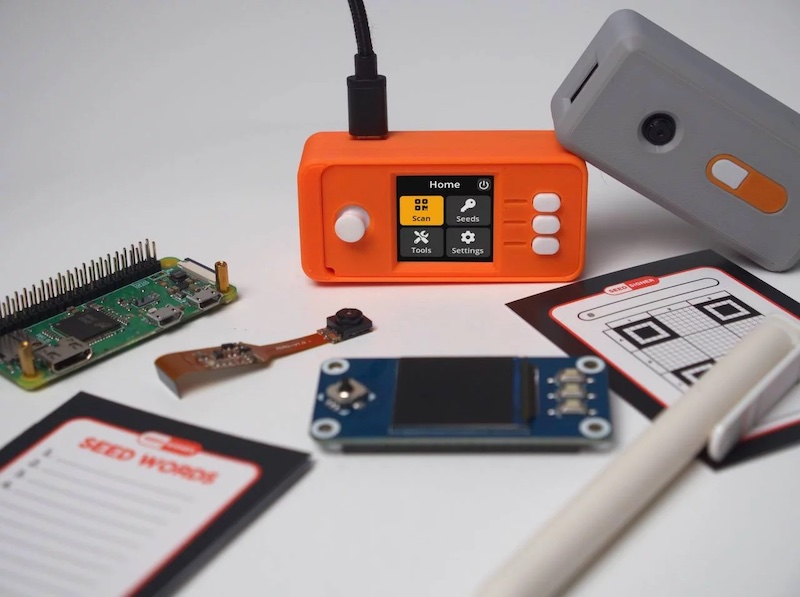
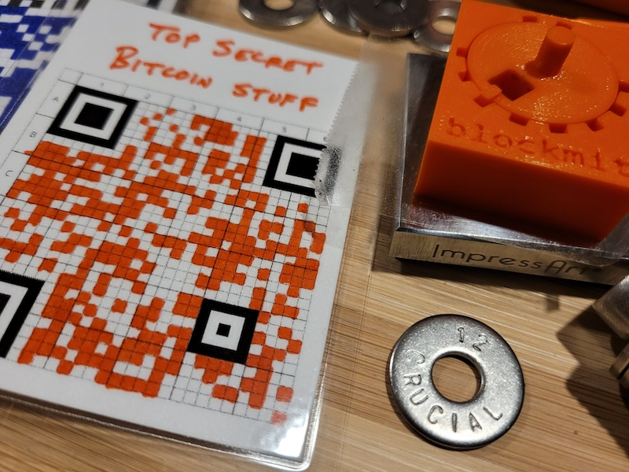

# SeedSigner fork: encrypted backup to a second card

This is a fork of [SeedSigner](https://github.com/SeedSigner/seedsigner) `d8f7956fff56a554f34946e8f5036661172765db` with one added flow: write an **encrypted** copy of a seed to a **second** card, and load it back. The image build is [seedsigner-os](https://github.com/SeedSigner/seedsigner-os) `c4cb767a00ace8edf5e9414450c2849e15958ad7` plus `os-patches/0001-usb-mass-storage-for-encrypted-backup.patch`, which turns USB mass storage back on. Upstream removes USB so a Pi Zero cannot see a card reader.

Nothing is written unless you open **Backup seed → Encrypted backup to SD** and press **Write backup**. The microSD slot that holds the OS (`mmcblk*`, `/mnt/microsd`, `/`, `/boot`) is refused. The app does not add network code.

## Security trade-offs — read this before real funds

This fork **leaves SeedSigner's stateless model**. Stock SeedSigner keeps the seed in RAM and can be run with the OS card removed after boot. This feature, once you confirm it, writes ciphertext to a card you plug in. That is a backup, and it is also a new way for a seed to leave the device.

- **Unaudited fork.** Upstream SeedSigner has not reviewed this change. Read the diff, especially `src/seedsigner/models/encrypted_backup.py` and `src/seedsigner/hardware/backup_volume.py`, before you trust it with a seed that matters. Test the whole export and import path with a **throwaway seed** first.
- **The OS card is still not a backup target.** The writer refuses `mmcblk*` names, anything mounted at `/`, `/boot`, `/boot/firmware`, or `/mnt/microsd`, and any `root=/dev/...` device from the kernel command line. A USB device that is itself the root disk is refused too. The strongest physical version of the old guarantee is still available: remove the OS card after the splash screen, then do the backup. The app cannot write a card that is not inserted.
- **Passphrase strength matters.** The KDF is scrypt with **N=2^15, r=8, p=4** (about 32 MiB). That fits a Pi Zero next to the camera and UI. It is a lighter work factor than age's default (N=2^18, ~256 MiB), which would risk locking the Zero up. Use a long passphrase (several diceware words). Eight characters is only the UI floor, not a recommendation. Letter case matters. The encryption passphrase is **not** the BIP-39 passphrase.
- **Cipher implementation.** On-device encryption is AES-256-GCM (FIPS 197, NIST SP 800-38D) written in that one module, with a known-answer self-test at import (an AES-256 block vector and an all-zero GCM tag). It is small on purpose so the image does not gain a new crypto package. It is not a general-purpose library. The same file decrypts the backup on a laptop.
- **USB is new attack surface.** The Pi Zero image used to ship with the USB controller compiled out (upstream marks those lines `# KEYBOARD`). This image builds in the USB host controller, SCSI disk, and `usb-storage` / UAS. On that Pi Zero image, HID, USB serial, USB gadget, and USB ethernet stay off. The Zero 2 W defconfig already included HID and USB serial upstream. Buildroot still sets the `CONFIG_NET` symbol for mdev, as upstream images do; IP networking stays off. Do not plug unknown USB devices into the signer.
- **Remove the card only after "Safe to remove".** The export path mounts read-write with `sync`, fsyncs the file, calls `sync`, then unmounts. If unmount fails the screen says the card is still mounted. Import mounts **read-only**.
- **The file is not a SeedQR and not a metal plate.** Anyone who later learns the encryption passphrase can restore the seed with the script below. Store the card and the passphrase as two separate secrets.

## What you need for the second card

The Pi Zero (and Zero 2 W) has **one** microSD slot. That slot is the OS card. The backup card is a second SD or microSD in a **USB** reader:

1. Raspberry Pi Zero, Zero W, or Zero 2 W, with the usual SeedSigner display and camera. Use the `pi0` image for Zero and Zero W. Use the `pi02w` image for Zero 2 W (upstream also boots that image on a Pi 3).
2. The OS microSD, flashed from the image in this repo's build artifacts.
3. A **micro-USB OTG adapter** (micro-USB plug to USB-A socket) in the Pi's **data** port. On a Zero that is the micro-USB port nearer the middle of the board, marked USB, not the power-only port at the corner.
4. A USB SD or microSD card reader.
5. A second card, partitioned MBR, formatted **FAT16 or FAT32**, with a normal filename-safe volume. This software does not partition or format cards. Do not use the OS card.

Power the Pi as usual (the power micro-USB, or the GPIO), with the OTG adapter on the data port.

## Using it on the device

Export, from a seed that is already in memory:

1. **Seeds → (fingerprint) → Backup seed → Encrypted backup to SD**
2. Read the warning. If the seed has a BIP-39 or Electrum passphrase, choose whether the file should include it. Leaving it out restores the mnemonic only.
3. Enter the **encryption** passphrase on the existing keyboard, then enter it again. They must match. At least 8 characters.
4. Plug in the reader and choose the USB volume. The boot card is not in the list.
5. **Write backup**. The screen pauses while scrypt runs (several seconds on a Pi Zero, sometimes longer).
6. Wait until the screen says **Safe to remove**, then unplug the reader.

The file name is `seedsigner-backup-YYYYMMDDTHHMMSSZ.ssenc` in the card's root. A second backup in the same second does not overwrite the first.

Import:

1. **Seeds → Load a seed → Encrypted SD backup**
2. Choose the USB card and the `.ssenc` file. The card is mounted read-only, the file is read into RAM, then the card is unmounted.
3. After **Safe to remove**, enter the encryption passphrase.
4. Check the fingerprint and whether a seed passphrase was in the file, then **Load seed**.

## Backup file format (SSENC1)

The layout is also the docstring of `src/seedsigner/models/encrypted_backup.py`. All multi-byte integers are big-endian.

| Offset | Size | Field |
| --- | --- | --- |
| 0 | 6 | ASCII magic `SSENC1` |
| 6 | 1 | Version `1` |
| 7 | 1 | KDF id `1` (scrypt) |
| 8 | 1 | Cipher id `1` (AES-256-GCM) |
| 9 | 1 | Flags, must be `0` |
| 10 | 4 | scrypt N |
| 14 | 4 | scrypt r |
| 18 | 4 | scrypt p |
| 22 | 16 | scrypt salt |
| 38 | 12 | GCM nonce |
| 50 | varies | ciphertext |
| last 16 | 16 | GCM tag |

The 50-byte header is GCM additional data, so edited KDF parameters fail authentication instead of being trusted. Files this device writes use N=32768, r=8, p=4, and a 32-byte key. Decryption reads N, r, and p from the header. Imports refuse parameters that would allocate more than 48 MiB (`128 * r * N`) or that are not a power-of-two N.

The encryption passphrase is normalized with Unicode **NFKD**, encoded as UTF-8, and passed to scrypt. The plaintext is compact UTF-8 JSON:

```json
{"format":"seedsigner-encrypted-backup","include_passphrase":true,"mnemonic":"word1 word2 ...","passphrase":"bip39 passphrase","seed_type":"bip39","version":1,"wordlist":"en"}
```

`passphrase` is omitted when you chose mnemonic only. `seed_type` is `bip39` or `electrum`. `wordlist` must be `en`. `seed_type` describes the mnemonic; it is not the encryption scheme.

## Decrypt off the device

Python 3.10 or newer, no packages to install. From a checkout of this repo, offline:

```bash
python3 tools/decrypt_seed_backup.py seedsigner-backup-20261028T120000Z.ssenc
```

The script prompts for the **encryption** passphrase with no echo. It prints the mnemonic and, if the file includes one, the seed passphrase. You can also place `src/seedsigner/models/encrypted_backup.py` beside the script and run it from that directory. A wrong passphrase or a modified file exits 2 and prints no seed.

Non-interactive form, which puts the passphrase in your shell history if you are not careful:

```bash
printf '%s\n' 'the encryption passphrase' | python3 tools/decrypt_seed_backup.py backup.ssenc
```

## Run the tests

```bash
python3 -m venv .venv
.venv/bin/pip install -r requirements.txt -r tests/requirements.txt -r l10n/requirements-l10n.txt
PYTHONPATH=src .venv/bin/python setup.py compile_catalog
PYTHONPATH=src .venv/bin/python -m pytest tests --ignore=tests/screenshot_generator
```

`tests/test_encrypted_backup.py` covers the encrypt/decrypt round trip, tampering, the scrypt parameter cap, and the standalone script. `tests/test_backup_volume.py` covers boot-device exclusion (onboard `mmcblk`, a USB disk that is `/` or `root=`, a non-USB disk) and checks that a refused device never reaches `mount`. Screenshot generation is the upstream tool and wants `libraqm`; it is not part of the backup tests.

## Build a flashable image

Upstream's Docker path is `docs` in seedsigner-os (`SS_ARGS="--pi0 --app-repo=... --app-branch=main"`). This environment built without Docker, which upstream also documents. Dependencies are the packages in `seedsigner-os/Dockerfile` (make, gcc, g++, patch, bc, libssl-dev, ncurses, rsync, unzip, cpio, dosfstools, mtools, python3, python3-virtualenv, and the rest of that list).

```bash
git clone https://github.com/SeedSigner/seedsigner-os.git
cd seedsigner-os
git checkout c4cb767a00ace8edf5e9414450c2849e15958ad7
git submodule update --init
patch -p1 < /path/to/this/repo/os-patches/0001-usb-mass-storage-for-encrypted-backup.patch
cd opt
./build.sh --pi0 --app-repo=/path/to/this/repo --app-branch=main
# optional second image (Pi Zero 2 W / Pi 3). Do not pass --skip-repo;
# the first build deletes extras out of the copied app tree.
./build.sh --pi02w --app-repo=/path/to/this/repo --app-branch=main
```

`tools/build_os_image.sh` in this repo runs those steps. Images land in `seedsigner-os/images/` as `seedsigner_os.<branch>.pi0.img` and, if you built it, `seedsigner_os.<branch>.pi02w.img`. The patch enables, as built-in (`=y`, because this kernel has `CONFIG_MODULES=n`):

- Pi Zero: `CONFIG_USB`, `CONFIG_USB_DWCOTG`, `CONFIG_USB_DWC2` host mode, `CONFIG_USB_STORAGE`, `CONFIG_USB_UAS`, `CONFIG_SCSI`, `CONFIG_BLK_DEV_SD`
- Pi Zero 2 W: storage, UAS, and SCSI (USB and DWC2 were already on for the Pi 3 ports)
- `dtoverlay=dwc2,dr_mode=host` on both boot configs, so the single OTG port enters host mode even when the adapter does not ground the ID pin
- ISO-8859-1 so FAT filenames have a code page

On the Pi Zero image the patch does **not** enable USB HID, USB serial, USB gadget mode, or USB ethernet. The Pi Zero 2 W defconfig already had USB, HID, and USB serial (upstream shares that config with the Pi 3); this fork adds mass storage and UAS on top of that. IP, packet sockets, Unix sockets, cfg80211, and Bluetooth stay off. Buildroot's mdev fixup still sets the `CONFIG_NET` symbol, which upstream images do too; there is no IP stack behind it. mdev still auto-mounts only `mmcblk0p1` (the OS card, read-mostly via the existing `nodirty` mount). USB volumes are mounted by the app, and only after you confirm.

A full buildroot run needs on the order of 20–30 GB of disk and a long compile. If it cannot finish, the app, the patch, and the commands above are still enough to build the image on another machine.

## Flash

Check the checksum, then write the **uncompressed** image to the OS card. Replace `/dev/sdX` with that card, not your computer's own disk and not the backup card.

```bash
xz -dk seedsigner_os.main.pi0.img.xz
sha256sum -c seedsigner_os.main.pi0.img.xz.sha256
sudo dd if=seedsigner_os.main.pi0.img of=/dev/sdX bs=4M conv=fsync status=progress
```

Raspberry Pi Imager's "Use custom" can write the `.img` as well. Boot the Pi with the display and camera attached. After the UI is up you may remove the OS card; plug the backup reader in only when you are ready to export or import.

The `pi0` image is the Raspberry Pi Zero and Zero W target (arm1176). The `pi02w` image is the Zero 2 W target upstream also uses for the Pi 3. The Zero 2 W config keeps `dtoverlay=disable-wifi` and `dtoverlay=disable-bt`. Neither image enables `CONFIG_INET`.

---

# Upstream SeedSigner

The rest of this file is the upstream project description. Where it says the device can only receive data by camera and can only send data by QR, that is still true **until** you use the encrypted-backup actions above.

# Build an offline, airgapped Bitcoin signing device for less than $50!



---------------

* [Project Summary](#project-summary)
* [Shopping List](#shopping-list)
* [Software Installation](#software-installation)
  * [Verifying your download](#verifying-your-download)
* [Enclosure Designs](#enclosure-designs)
* [SeedQR Printable Templates](#seedqr-printable-templates)
* [Build from Source](#build-from-source)
* [Developer Local Build Instructions](#developer-local-build-instructions)


---------------

# Project Summary

[](https://github.com/SeedSigner/seedsigner/actions/workflows/tests.yml)
[](https://github.com/SeedSigner/seedsigner/actions/workflows/build.yml)

The goal of SeedSigner is to lower the cost and complexity of Bitcoin multisignature wallet use. To accomplish this goal, SeedSigner offers anyone the opportunity to build a verifiably air-gapped, stateless Bitcoin signing device using inexpensive, publicly available hardware components (usually < $50). SeedSigner helps users save with Bitcoin by assisting with trustless private key generation and multisignature (aka "multisig") wallet setup, and helps users transact with Bitcoin via a secure, air-gapped QR-exchange signing model.

Additional information about the project can be found at [SeedSigner.com](https://seedsigner.com).

You can follow [@SeedSigner](https://twitter.com/SeedSigner) on Twitter for the latest project news and developments.

If you have specific questions about the project, our [Telegram Group](https://t.me/joinchat/GHNuc_nhNQjLPWsS) is a great place to ask them.

### Feature Highlights:
* Stateless, air-gapped operation:
  * Temporarily stores seeds in memory while the device is powered; all memory is wiped when power is removed.
  * SD card removable after boot to ensure no secret data can be written to it.
  * No WiFi or Bluetooth hardware onboard.
  * Can only receive data via reading QR codes with its camera.
  * Can only send data by displaying QR codes on its screen.

* Trustless, auditable:
  * Completely FOSS code, MIT license
  * Reproducible builds
  * Created and maintained by volunteers. There is no corporation. No profit motive.

* Creating and handling seeds:
  * Create a seed phrase by picking BIP39 words, calculates the final word (aka checksum).
  * Create a seed phrase [via dice rolls](docs/dice_verification.md).
  * Create a seed phrase via image entropy from the onboard camera.
  * Guided interface to manually transcribe a seed to the SeedQR format for instant seed loading [(video)](https://youtu.be/c1-PqTNx1vc).
  * BIP39 passphrase (aka 13th or 25th word) support.
  * Import any existing seed phrase via an optimized seed word entry interface.
  * Partial support for Electrum Segwit seed phrases [(info)](docs/electrum.md).

* Wallet setup and transaction signing:
  * Script types: Taproot, native segwit, nested segwit, legacy (p2pkh).
  * Single sig and multisig xpub export.
  * Support for user-defined custom derivation paths.
  * In-depth transaction (aka PSBT) review flow before signing.
  * Verify the PSBT's single sig or multisig change outputs or self-transfer outputs.
  * Mainnet, testnet, and regtest.

* Additional utilities:
  * [SettingsQR](https://github.com/SeedSigner/seedsigner-settings-generator) to instantly reconfigure a SeedSigner for beginners, advanced users, or tailored to your preferences.
  * Scan a software wallet's receive or change address to verify that it's correct.
  * Address Explorer for single sig and multisig wallets.
  * Message signing to prove address ownership.
  * BIP85 child seed generation.

* Compatible with:
  * Sparrow
  * Nunchuk
  * Keeper
  * BlueWallet
  * Specter Desktop
  * Any bitcoin wallet software that supports QR codes

* Supported languages:
  * English
  * Español
  * Many more coming soon!


---------------

# Shopping List

To build a SeedSigner, you will need:

* Raspberry Pi Zero
  * Preferably version 1.3 which has no WiFi/Bluetooth capability, but any Raspberry Pi 2/3/4 or Zero "W"/"2W" model will work.
* Waveshare 1.3" 240x240 LCD (MUST be the 240x240 version!) https://www.waveshare.com/wiki/1.3inch_LCD_HAT.
* Pi Zero-compatible camera (tested to work with the Aokin / AuviPal 5MP 1080p with OV5647 Sensor).

Notes:
* You may need to solder the 40 GPIO pins (20 pins per row) to the Raspberry Pi Zero board. If you don't want to solder, most stores offer the board "with headers" already soldered on.
* The Pi Zero "W" or "2W" is often easier to find but has WiFi/Bluetooth hardware. You can still use these boards and can optionally [disable the WiFi/Bluetooth hardware](https://github.com/DesobedienteTecnologico/rpi_disable_wifi_and_bt_by_hardware).
* Other cameras with the above sensor module should work, but may not fit in the Orange Pill enclosure.
* Choose the Waveshare screen carefully; they make a number of different boards that look very similar but ARE NOT COMPATIBLE! Make sure you purchase the model that has a resolution of 240x240 pixels.
* Raspberry Pi 1 is also compatible, but will require a [hardware modification to the Waveshare LCD Hat](./docs/legacy_hardware.md).

---------------

# Software Installation

## A Special Note On Minimizing Trust
As is the nature of pre-packaged software downloads, downloading and using the prepared SeedSigner release images means implicitly placing trust in the people preparing those images; in our project the released images are prepared and signed by the eponymous creator of the project, SeedSigner "the person". That individual is additionally the only person in possession of the PGP keys that are used to sign the release images.

Starting with v0.7.0, the images distributed via GitHub are reproducible. This means you and others can verify the released images are byte-for-byte the same when built from source. You can contribute to this project by building from source and sharing the hash of the final images.

Instructions to build a SeedSigner OS image (using precisely the same process that is used to create the prepared release images) have been made available. We have put a lot of thought and work into making these instructions easy to understand and follow, even for less technical users. These instructions can be found [here](https://github.com/SeedSigner/seedsigner-os/blob/main/docs/building.md).

## Downloading the Software

   
Download the current Version (0.8.7) software image that is compatible with your  Raspberry Pi Hardware. The Pi Zero 1.3 is the most common and recommended board.
| Board                 | Download Image Link/Name          |
| --------------------- | --------------------------------- |
|**[Raspberry Pi Zero 1.3](https://www.raspberrypi.com/products/raspberry-pi-zero/)**      |[`seedsigner_os.0.8.7.pi0.img`](https://github.com/SeedSigner/seedsigner/releases/download/0.8.7/seedsigner_os.0.8.7.pi0.img)      |
|[Raspberry Pi Zero W](https://www.raspberrypi.com/products/raspberry-pi-zero-w/)    |[`seedsigner_os.0.8.7.pi0.img`](https://github.com/SeedSigner/seedsigner/releases/download/0.8.7/seedsigner_os.0.8.7.pi0.img)      |
|[Raspberry Pi Zero 2 W](https://www.raspberrypi.com/products/raspberry-pi-zero-2-w/)  |[`seedsigner_os.0.8.7.pi02w.img`](https://github.com/SeedSigner/seedsigner/releases/download/0.8.7/seedsigner_os.0.8.7.pi02w.img)    |
|[Raspberry Pi 1 Model B/B+](https://www.raspberrypi.com/products/raspberry-pi-1-model-b-plus/) |[`seedsigner_os.0.8.7.pi0.img`](https://github.com/SeedSigner/seedsigner/releases/download/0.8.7/seedsigner_os.0.8.7.pi0.img)      |
|[Raspberry Pi 2 Model B](https://www.raspberrypi.com/products/raspberry-pi-2-model-b/) |[`seedsigner_os.0.8.7.pi2.img`](https://github.com/SeedSigner/seedsigner/releases/download/0.8.7/seedsigner_os.0.8.7.pi2.img)      |
|[Raspberry Pi 3 Model B](https://www.raspberrypi.com/products/raspberry-pi-3-model-b/) |[`seedsigner_os.0.8.7.pi02w.img`](https://github.com/SeedSigner/seedsigner/releases/download/0.8.7/seedsigner_os.0.8.7.pi02w.img)    |
|[Raspberry Pi 4 Model B](https://www.raspberrypi.com/products/raspberry-pi-4-model-b/) |[`seedsigner_os.0.8.7.pi4.img`](https://github.com/SeedSigner/seedsigner/releases/download/0.8.7/seedsigner_os.0.8.7.pi4.img)      |
|[Raspberry Pi 400](https://www.raspberrypi.com/products/raspberry-pi-400-unit/) |[`seedsigner_os.0.8.7.pi4.img`](https://github.com/SeedSigner/seedsigner/releases/download/0.8.7/seedsigner_os.0.8.7.pi4.img)      |

Note: If you have physically removed the WiFi component from your board, you will still use the image file of the original (un-modified) hardware. (Our files are compiled/based on the *processor* architecture). Although it is better to spend a few minutes upfront to determine which specific Pi hardware/model you have, if you are still unsure which hardware you have, you can try using the pi0.img file. Making an incorrect choice here will not ruin your board, because this is software, not firmware. 

**Also download** these 2 signature verification files to the same folder  
[The Plaintext manifest file](https://github.com/SeedSigner/seedsigner/releases/download/0.8.7/seedsigner.0.8.7.sha256.txt)  
[The Signature of the manifest file](https://github.com/SeedSigner/seedsigner/releases/download/0.8.7/seedsigner.0.8.7.sha256.txt.sig)


Users familiar with older versions of the SeedSigner software might be surprised with how fast their software downloads now are, because since version 0.6.0 the software image files are now 100x smaller! Each image file is now under 42 Megabytes so your downloads and verifications will be very quick now (and might even seem *too* quick)!  

Once the files have all finished downloading, follow the steps below to verify the download before continuing on to write the software onto a MicroSD card. Next, insert the MicroSD into your assembled hardware and connect the USB power. Allow about 45 seconds for our logo to appear, and then you can begin using your SeedSigner! 

[Our previous software versions are available here](https://github.com/SeedSigner/seedsigner/releases). Choose a specific version and then expand the *Assets* sub-heading to display the .img file binary and also the 2 associated signature files. **Note:** The prior version files will have lower numbers than the scripts and examples provided in this document, but the naming format will be the same, so you can edit them as required for signature verification etc.   


## Verifying your download

You can quickly verify that the software you just downloaded is both authentic and unaltered by following these instructions.
We assume you are running the commands from a computer where both [GPG](https://gnupg.org/download/index.html) and [shasum](https://command-not-found.com/shasum) are already installed and that you also know [how to navigate on a terminal](https://terminalcheatsheet.com/guides/navigate-terminal). 

> You must run the following verification before opening or mounting the .img file.
> Some operating systems modify the file on mount, causing verification to fail.

### Step 1. Verify that the signature (.sig) file is genuine:

Run GPG's *fetch-keys* command to import the SeedSigner project's public key from the popular online keyserver called *Keybase.io*, into your computer's *keychain*. 


```
gpg --fetch-keys https://keybase.io/seedsigner/pgp_keys.asc
```
The result should confirm that 1 key was *either* imported or updated. *Ignore* any key ID's or email addresses shown.

  

Next, you will run the *verify* command on the signature (.sig) file. (*Verify* must be run from inside the same folder that you downloaded the files into earlier.)   
```
gpg --verify seedsigner.0.8.7.sha256.txt.sig
```

When the verify command completes successfully, it should display output like this:
<BR>
  
The result must display "**Good signature**".  Ignore any email addresses - *only*  matching Key fingerprints count here. Stop immediately if it displays "*Bad signature*"!
<BR> 

On the *last* output line, look at your *rightmost* 16 characters (the 4 blocks of 4).  
**Crucially, we must now check WHO that Primary key fingerprint /ID belongs to.** We will start by looking at Keybase.io to see if it is the *SeedSigner project*'s public key or not.

<details><summary> About the warning message:</summary>
<p>  Since you are about to match the outputted fingerprint/ID against the proofs at Keybase.io/SeedSigner, and thereby confirm who the pubkey really belongs to-, you can safely ignore this warning message:

```
> WARNING: This key is not certified with a trusted signature!  
> There is no indication that the signature belongs to the owner.
 ```
</p>
</details>
<br>

<details><summary> More about how the verify command works:</summary>
<p>  
The verify command will attempt to decrypt the signature file (sha256.sig) by trying each public key already imported into your computer. If the public key we just imported (via fetch-keys), manages to: (a) successfully decrypt the .sig file , and (b), that result matches exactly to the clear-text equivalent (.sha256) of the .sig file, then it's "a good signature"!   

Crucially, we must still manually check who *exactly* owns the Key ID which gave us that "Good signature". That's what the warning message means- Who does the matching key really belong to? We will start by looking at keybase.io to see if it is "The SeedSigner project"'s public Key or not. 
Note that it is the file hashes of .sig and .sha256 that *verify* compares, not their raw contents.

</p>
</details>
<br>

Now to determine ***who*** the Public key ID belongs to: Go to [Keybase.io/SeedSigner](https://keybase.io/seedsigner)  
<BR>


**You must now *manually* compare: The 16 character fingerprint ID (as circled in red above) to, those *rightmost* 16 characters from your *verify* command.** 

**If they match exactly, then you have successfully confirmed that your .sig file is authentically from the SeedSigner Project!**
<BR>

<details><summary>Learn more about how keybase.io helps you check that someone (online) is who they say they are:</summary>
<p>
Keybase.io allows you to independently verify that the public key saved on Keybase.io, is both authentic and that it belongs to the organization it claims to represent.  
 Keybase has already checked the three pubkey file locations cryptographically when they were saved there. You can further verify the key publications if you would like:  
 
 - *via Keybase*: By clicking on any of the three blue badges to see that the "proof" was published at that location. (The blue badge marked as tweet, is in the most human-readable form and it is also a bi-directional link on Twitter)    
or, 
 - *without keybase (out-of-band)*: By using these 3 links directly: [Twitter](https://twitter.com/SeedSigner/status/1530555252373704707), [Github](https://gist.github.com/SeedSigner/5936fa1219b07e28a3672385b605b5d2) and [SeedSigner.com](https://seedsigner.com/keybase.txt). This method can be used if you would like to make an even deeper, independent inspection without relying on Keybase at all, or if the Keybase.io site is no longer valid or it is removed entirely. 

Once you have used one of these methods, you will know if the Public Key stored on Keybase, is genuinely from the SeedSigner Project or not.
</p>
</details>
<br>

If the two ID's do *not* match, then you must stop here immediately. Do not continue. Contact us for assistance in the Telegram group address above.

<br>

### Step 2. Verifying that the *software images/binaries* are genuine

Now that you have confirmed that you do have the real SeedSigner Project's Public Key (ie the 16 characters match) - you can return to your terminal window. Running the *shasum* command, is the final verification step and will confirm (via file hashing) that the software code/image files, were also not altered since publication, or even during your download process.  
(Prior to version 0.6.0, your verify command will check the .zip file which contains the binary files.)

 **On Linux or OSX:** Run this command
```
shasum -a 256 --ignore-missing --check seedsigner.0.8.7.sha256.txt  
```
Note: macOS versions earlier than v11 (Big Sur) do not support the `--ignore-missing` flag. You can omit it and disregard any missing file warnings.

**On Windows (inside Powershell):** Run this command
```
CertUtil -hashfile  seedsigner_os.0.8.7.Insert_Your_Pi_Models_binary_here_For_Example_pi02w.img SHA256 
```
On Windows, you must then manually compare the resulting file hash value to the corresponding hash value shown inside the .SHA256 cleartext file.
 <BR>

Wait up to 30 seconds for the command to complete, and it should display:
```
seedsigner_os.0.8.7.[Your_Pi_Model_For_Example:pi02w].img: OK
```
**If you receive the "OK" message** for your **seedsigner_os.0.8.7.[Your_Pi_Model_For_Example:pi02w].img file**, as shown above, then your verification is fully complete!  
**All of your downloaded files have now been confirmed as both authentic and unaltered!** You can proceed to create/write your MicroSD card😄😄 !!     

If your file result shows "FAILED", then you must stop here immediately. Do not continue. Contact us for assistance at the Telegram group address above.

<BR>

Please recognize that this process can only validate the software to the extent that the entity that first published the key is an honest actor, and their private key is not compromised or somehow being used by a malicious actor.
<BR>
<BR>


## Writing the software onto your MicroSD card

To write the SeedSigner software onto your MicroSD card, there are a few options available:   
| Application              | Description                                                                                                                                                  | Platform and official Source                                                         |
|--------------------------|--------------------------------------------------------------------------------------------------------------------------------------------------------------|--------------------------------------------------------------------------------------|
| Balena Etcher            | The application is called Etcher, and the company that wrote it is called Balena.  Hence *Etcher by Balena* or *Balena Etcher*                                                  | [Available for Windows, Mac and Linux](https://www.balena.io/etcher#download-etcher) |
| Raspberry Pi Imager      | Produced by the Raspberry Pi organization.                                                                                                                   | [Available for Windows, Mac and Linux](https://www.raspberrypi.com/software/)        |
| DD Command Line Utility  | Built-in to Linux and MacOS, the DD (Data Duplicator) is a tool for advanced users.  If not used carefully it can accidentally format the incorrect disk!   | Built-in to Linux and MacOS                                                        |

Be sure to download the software from the genuine publisher.  
Either of the Etcher or Pi Imager software is recommended.  Some SeedSigner users have reported a better experience with one or the other. So, if the one application doesn't work well for your particular machine, then please try the other one. 
<BR>
### **General Considerations:** 
The writing and verify steps are very quick from version 0.6.0 upwards, so please pay close attention to your screen. 
Make sure to set any write-protection physical slider on the MicroSD Card Adapter to UN-locked.  
You also don't need to pre-format the MicroSD beforehand.  You *don't* need to unzip any .zip file beforehand.
Current Etcher and Pi Imager software will perform a verify action (by default) to make sure the card was written successfully! Watching for that verify step to complete successfully, can save you a lot of headaches if you later need to troubleshoot issues where your SeedSigner device doesn't boot up at power on.   
Writing the MicroSD card is also known as flashing.  
It will overwrite everything on the MicroSD card.  
If the one application fails for you, then please try again using our other recommended application.  
Advanced users may want to try the Linux/MacOS *DD* command instead of using Etcher or Pi Imager, however, a reminder is given that DD can overwrite the wrong disk if you are not careful!
#### **Specific considerations for Windows users:**
Use the Pi imager software as your first choice on Windows. Windows can sometimes flag the writing of a MicroSD as risky behaviour and hence it may prevent this activity. If this happens, your writing/flashing will fail, hang or won't even begin, in which case you should try to run the Etcher/Pi-Imager app "As administrator", (right-click and choose that option). It can also be blocked by windows security in some cases, so If you have the (non-default) *Controlled Folder Access* option set to active, try turning that *off* temporarily. 


---------------

# Enclosure Designs

### Open Pill

The Open Pill enclosure design is all about quick, simple and inexpensive deployment of a SeedSigner device. The design does not require any additional hardware and can be printed using a standard FDM 3D printer in about 2 hours, no supports necessary. A video demonstrating the assembly process can be found [here](https://youtu.be/gXPFJygZobEa). To access the design file and printable model, click [here](https://github.com/SeedSigner/seedsigner/tree/main/enclosures/open_pill).

### Orange Pill

The Orange Pill enclosure design offers a more finished look that includes button covers and a joystick topper. You'll also need the following additional hardware to assemble it:

* 4 x F-F M2.5 spacers, 10mm length
* 4 x M2.5 pan head screws, 6mm length
* 4 x M2.5 pan head screws, 12mm length

The upper and lower portions of the enclosure can be printed using a standard FDM 3D printer, no supports necessary. The buttons and joystick nub should ideally be produced with a SLA/resin printer. An overview of the entire assembly process can be found [here](https://youtu.be/aIIc2DiZYcI). To access the design files and printable models, click [here](https://github.com/SeedSigner/seedsigner/tree/main/enclosures/orange_pill).

### Community Designs

* [Lil Pill](https://cults3d.com/en/3d-model/gadget/lil-pill-seedsigner-case) by @_CyberNomad
* [OrangeSurf Case](https://github.com/orangesurf/orangesurf-seedsigner-case) by @OrangeSurfBTC
* [PS4 SeedSigner](https://www.thingiverse.com/thing:5363525) by @Silexperience
* [OpenPill Faceplate](https://www.printables.com/en/model/179924-seedsigner-open-pill-cover-plates-digital-cross-jo) by @Revetuzo 
* [Waveshare CoverPlate](https://cults3d.com/en/3d-model/various/seedsigner-coverplate-for-waveshare-1-3-inch-lcd-hat-with-240x240-pixel-display) by @Adathome1

---------------

# SeedQR Printable Templates
You can use SeedSigner to export your seed to a hand-transcribed SeedQR format that enables you to instantly load your seed back into SeedSigner.

[More information about SeedQRs](docs/seed_qr/README.md)

<table align="center">
    <tr><td></td></tr>
</table>

Standard SeedQR templates:
* [12-word SeedQR template dots (25x25)](docs/seed_qr/printable_templates/dots_25x25.pdf)
* [24-word SeedQR template dots (29x29)](docs/seed_qr/printable_templates/dots_29x29.pdf)
* [12-word SeedQR template grid (25x25)](docs/seed_qr/printable_templates/grid_25x25.pdf)
* [24-word SeedQR template grid (29x29)](docs/seed_qr/printable_templates/grid_29x29.pdf)
* [Baseball card template: 24-word SeedQR (29x29)](docs/seed_qr/printable_templates/trading_card_29x29_w24words.pdf)

CompactSeedQR templates:
* [12-word CompactSeedQR template dots (21x21)](docs/seed_qr/printable_templates/dots_21x21.pdf)
* [24-word CompactSeedQR template dots (25x25)](docs/seed_qr/printable_templates/dots_25x25.pdf)
* [12-word CompactSeedQR template grid (21x21)](docs/seed_qr/printable_templates/grid_21x21.pdf)
* [24-word CompactSeedQR template grid (25x25)](docs/seed_qr/printable_templates/grid_25x25.pdf)
* [Baseball card template: 12-word Compact SeedQR (21x21)](docs/seed_qr/printable_templates/trading_card_21x21_w12words.pdf)
* [Baseball card template: 24-word Compact SeedQR (25x25)](docs/seed_qr/printable_templates/trading_card_25x25_w24words.pdf)


2-sided SeedQR templates - 8 per sheet
Printing settings - (2-sided)("flip on long edge")("Actual Size")
If printing on cardstock, adjust your printer settings via its control panel

A4 templates(210mm * 297mm):
* [21x21 - stores 12-word seeds ONLY in CompactSeedQR format ONLY](docs/seed_qr/printable_templates/21x21_A4_trading_card_2sided.pdf)
* [25x25 - stores 12-word or 24 word seeds depending on SeedQR format](docs/seed_qr/printable_templates/25x25_A4_trading_card_2sided.pdf)
* [29x29 - stores 24-word seeds ONLY as plaintext SeedQR format ONLY](docs/seed_qr/printable_templates/29x29_A4_trading_card_2sided.pdf)

Letter templates(8.5in * 11in):
* [21x21 - stores 12-word seeds ONLY in CompactSeedQR format ONLY](docs/seed_qr/printable_templates/21x21_letter_trading_card_2sided.pdf)
* [25x25 - stores 12-word or 24 word seeds depending on format](docs/seed_qr/printable_templates/25x25_letter_trading_card_2sided.pdf)
* [29x29 - stores 24-word seeds ONLY as plaintext SeedQR format ONLY](docs/seed_qr/printable_templates/29x29_letter_trading_card_2sided.pdf)
---------------

# Build from Source
See the [SeedSigner OS repo](https://github.com/SeedSigner/seedsigner-os/) for instructions.

# Developer Local Build Instructions
Raspberry Pi OS is commonly used for development. See the [Raspberry Pi OS Build Instructions](docs/raspberry_pi_os_build_instructions.md)
